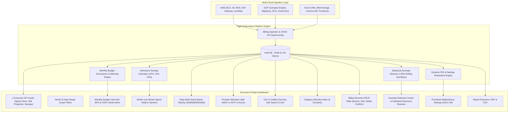

# Cloud Cost Optimization & FinOps Analytics Platform (B.Tech Final Year Project)

[](https://nodejs.org/)
[](https://sqlite.org/)
[](#)
[](#)

A production-grade, multi-cloud cost intelligence, governance, and optimization platform built with zero heavy database overhead. Powered natively by **Node.js v22 built-in SQLite engine (`node:sqlite`)**, **Tailwind CSS**, **Lucide Icons**, and **Chart.js**.

---

## Architecture Overview



---

## 🌟 Key Features Implemented (B.Tech Project Specifications)

1. **Date & Month Scope Filtering**:
   - Filter by specific billing month (`2026-11`, `2026-10`, `2026-09`, etc.) or custom date ranges (`startDate` to `endDate`).
   - Automatically synchronizes all executive KPIs, charts, and tables in real time.

2. **Budget Management & Overrun Alerts**:
   - Set monthly cloud budgets with persistent SQLite storage.
   - Live budget utilization percentage and remaining cash balance.
   - **Automated Threshold Warnings**:
     - 🟢 **Normal (< 80%)**: Healthy utilization.
     - 🟡 **Warning (80% - 99%)**: High spend alert banner.
     - 🔴 **Critical (>= 100%)**: Visual budget overrun banner showing exact overspend amount.

3. **Month-over-Month Cost Comparison**:
   - Direct comparison between the current month and previous month.
   - Calculates exact dollar increase/decrease and percentage variance with color-coded badges.

4. **Top 5 Costliest Services**:
   - Ranked list of the 5 most expensive cloud services.
   - Real-time search filter and dynamic sorting (`Cost: High-to-Low`, `Cost: Low-to-High`, `Name: A-Z`).

5. **Interactive Savings Calculator**:
   - Instant 10%, 15%, 20% (or custom %) reduction simulator.
   - Calculates estimated monthly savings, annualized savings, and projected net spend based on real telemetry.

6. **Executive Report Exports (PDF & CSV)**:
   - **Download CSV**: RFC 4180 compliant billing audit export with active filter support.
   - **Printable Executive PDF Report**: Branded printable view with automated print-to-PDF formatting (`/api/export/report`).

7. **Billing Records Management (CRUD)**:
   - Searchable, paginated table of billing records.
   - **Add**: Validated record creation.
   - **Edit**: Modal interface with pre-filled inputs and validation.
   - **Delete**: Protected deletion with modal confirmation prompt.

8. **Statistical Anomaly Detection & Action Hub**:
   - Flags daily service cost spikes exceeding **>30% from 14-day rolling mean**.
   - Root-cause diagnostics for orphaned resources (unattached EBS volumes, unassociated Elastic IPs, unpartitioned BigQuery scans).
   - Prioritized savings recommendations with real-time ROI recalculation.

---

## 🚀 Quickstart Guide

### 1. Open Terminal in Project Folder:
```cmd
cd C:\Users\enumu\finops-platform
```

### 2. Run Automated Verification Test Suite:
```cmd
npm test
```
*All 26 test specifications across 8 suites will run and pass with a 100% success rate.*

### 3. Start the Server:
```cmd
node server.js
```
*Open your browser at: **[http://localhost:3000](http://localhost:3000)***

---

## 🎓 Viva & Presentation Talking Points

1. **Why Node.js v22 built-in SQLite?**
   - *"Traditional web apps require setting up standalone database servers like MySQL or PostgreSQL, introducing latency and configuration overhead. We utilized Node.js v22's native `node:sqlite` (`DatabaseSync`), achieving in-process C++ speed with zero daemon dependencies."*

2. **How does Budget Governance work?**
   - *"Budgets are maintained on a monthly basis. When incurred cost crosses 80% or 100% of the allocated ceiling, the system triggers proactive warnings on the executive overview."*

3. **How does the Savings Calculator connect to actual data?**
   - *"The calculator queries the database for the active month's actual recorded spend. When the evaluator selects 10%, 15%, or 20%, it calculates real-time monthly and annualized ROI dynamically."*
